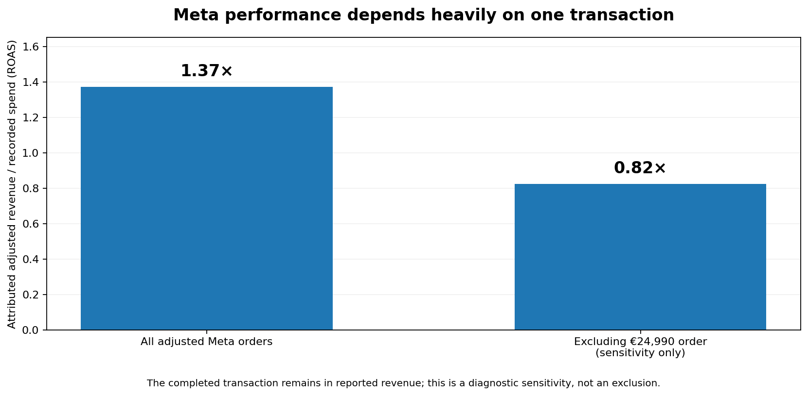
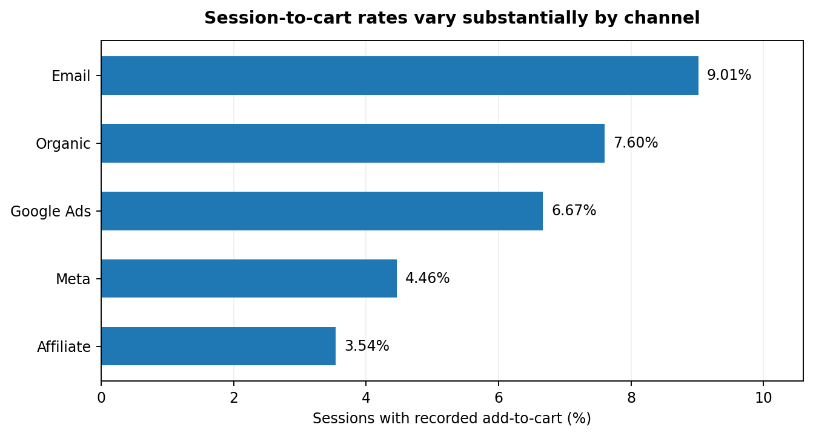

# E-commerce Marketing Analytics: Attribution, Funnel Analysis & Budget Optimisation

**Python · pandas · Excel · attribution analysis · data quality · commercial decision-making**

## Business question

Using a **synthetic e-commerce dataset** covering January–June 2026, assess the performance and quality of marketing channels, identify observable purchase-funnel gaps, and develop a financially controlled Q3 budget recommendation. The analysis separates **last-click attribution, purchase behaviour, source-data quality and economic decisions** rather than treating historical ROAS as incremental profit.

## Three executive findings

**1. Meta’s reported ROAS depends materially on one completed transaction.** The €24,990 Meta sale accounts for **39.9%** of its six-month adjusted attributed revenue. Meta’s reported ROAS is **1.37×**, falling to **0.82×** in a diagnostic comparison without that single purchase. The transaction **remains included** in all primary sales and results.

**2. The largest measurable purchase-funnel gap is before add-to-cart.** Across **293,692** observed sessions, **16,441 (5.60%)** included an add-to-cart event and **6,490** checkout starts were recorded. Affiliate and Meta have the lowest session-to-cart rates at **3.54%** and **4.46%**. The underlying extract lacks session-to-order identifiers: checkout/cart ratios are aggregate counts, **not verified within-session transitions**.

**3. High attributed ROAS is not evidence of incremental profitability.** Email’s six-month attributed ROAS reaches **14.55×**, but **368/540** attributed Email orders followed an earlier observed purchase. Google Ads’ Q2 ROAS of **1.21×** implies an **82.7% historical break-even contribution margin before advertising**; actual contribution margins and causal lift are unavailable.

### Financial baseline

| Metric | Jan–Jun 2026 |
|---|---:|
| Positive completed purchases | 3,065 |
| Positive completed revenue | €212,282.52 |
| All recorded negative adjustments | −€719.51 (12 records) |
| **Adjusted attributed revenue** | **€211,563.01** |
| Adjusted paid-channel attributed revenue | €168,265.85 |
| Paid-media expenditure | €103,861.75 |
| **Paid-channel attributed ROAS** | **1.620×** |
| Recorded sessions | 293,692 |
| Purchasing customers | 2,020 (2,005 acquisition-channel matched) |

Orders count positive completed purchases only; **all 12 negative adjustments**, including negative returned/cancelled records, reduce financial attributed revenue. Positive cancelled/returned orders and the conflicting `O500891` records are excluded. Organic revenue is included in adjusted total revenue but not in paid ROAS.

## Management decision — test alternatives, authorise none automatically

Maintain the **€52,853.72 Q2-equivalent quarterly paid-media envelope**. Examine a capped **€624.09** transfer *from Meta*, equivalent to increasing **Affiliate’s own Q2 spend by 10%** under the preferred option.

| Alternative | Affiliate change | Google Ads change | Meta change |
|---|---:|---:|---:|
| A — Diversified 60/40 | +€374.45 | +€249.64 | −€624.09 |
| **B — Affiliate only (conditional preference)** | **+€624.09** | **€0** | **−€624.09** |
| C — Google only | €0 | +€624.09 | −€624.09 |

Every option preserves the total budget; **none predicts additional sales or profit**. Affiliate’s steadier monthly attributed ROAS motivates the preferred *small-scale test*, while lower session-to-cart progression and unverified contribution margins are material counter-evidence. Google Ads’ historical break-even hurdle is higher; Meta's apparent strength is concentrated in one order.

**Decision status: HOLD UPLIFT.** A 42-day pilot is a conditional spend-cap review, **not** a powered A/B test. Release requires Finance and Marketing sign-off on contribution margins, returns/cancellation tolerances, reporting maturity lag, and budget caps. The signed-off values are deliberately blank in the management report.

## Analytical method and data-quality controls

- **Order reconciliation:** Deduplicate by order ID, quarantine the two conflicting `O500891` records (€101.21 versus €18,450), separate positive completed purchases from signed adjustments, and preserve the valid €24,990 Meta sale.
- **Spend quality:** Provisionally remove 20 exact duplicate campaign-spend records (€1,268.45), pending source-ledger verification.
- **Time series and attribution:** Reconcile signed monthly and channel revenue to overall adjusted revenue; report campaign CTR/CPC/CPM without inventing campaign-level revenue attribution.
- **Funnel and customer analysis:** Distinguish unlinked event-stage ratios, missing session dates (11–13 April) and observed first/repeat purchasing from causal retention or lifetime value.
- **Budget governance:** Compare constant-envelope allocations, separately calculate six-week exposure caps, and keep a formula-based approval gate at HOLD until required inputs are supplied.

## Project contents

| File | Purpose |
|---|---|
| [`marketing_management_report.xlsx`](marketing_management_report.xlsx) | **Final seven-sheet decision report:** Executive Summary, Channel Performance, Purchase Funnel, Budget Decision, Trends & Campaigns, Customers, Methods & Quality |
| [`marketing_analysis.ipynb`](marketing_analysis.ipynb) | Source-level Python analysis, revised for all 12 adjustments, Meta sensitivity, reconciled Q2 economics and three budget options, plus source-driven PASS/FAIL checks |
| `meta_roas_sensitivity_audited.png` | Final report-based Meta sensitivity chart |
| `session_to_cart_by_channel.png` | Funnel comparison chart |

## Evidence and reproducibility

**The source workbook `Shop_online_data.xlsx` is not included**, so the revised source-level notebook **has not been re-executed** and old outputs incompatible with the new financial policy were intentionally removed. The notebook contains explicit **reference figures from the final Excel report**, independently inspectable alongside Python code that recomputes them when the source is available. It requires `pandas`, `matplotlib` and `openpyxl` (plus the normal Jupyter environment); no separate `requirements.txt` or installation tutorial is included.

The reporting figures and Excel formula outputs were checked for internal consistency. Without the synthetic source file and verified accounting ledger, this is **not an independent audit of transaction authenticity**. Attributed ROAS is descriptive, not contribution profit or incremental return. The budget alternatives are constrained hypotheses, not forecasts or a proven optimum.

**Project type:** Independent analysis of synthetic e-commerce data; not company financial statements.
